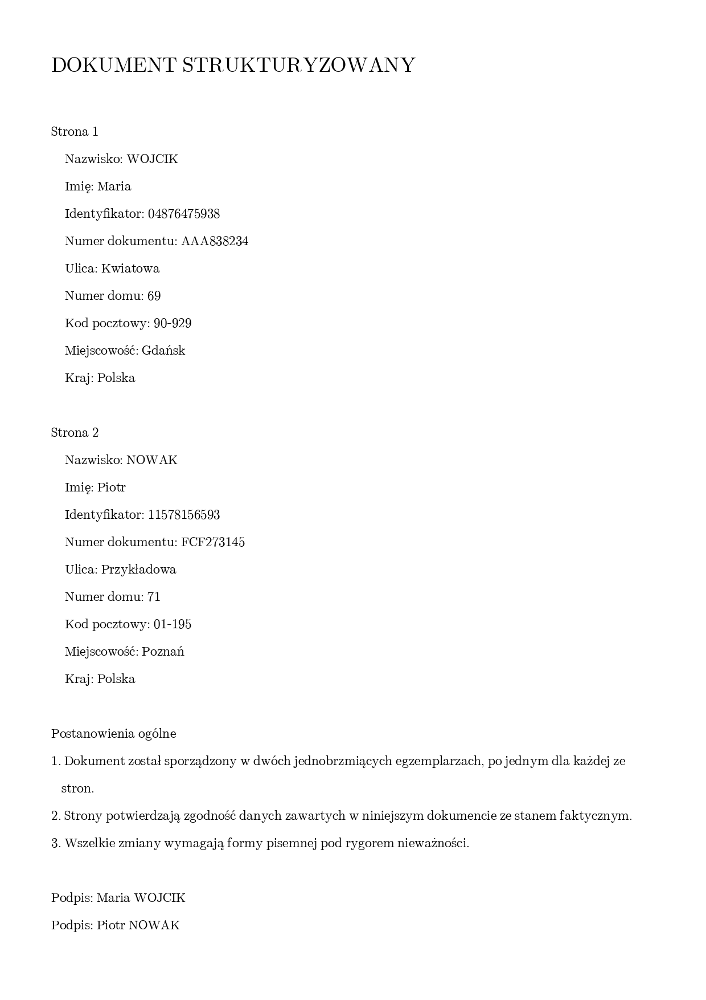

# polish-document-ocr

Stock OCR reads Polish and loses the diacritics. This builds the training data
that fixes that, trains a recogniser on it, and measures the difference.

On 680 words held out of training, docTR reads **45.4%** exactly right and
**86.7%** with diacritics folded away, so **41.4% of its errors are a missing
accent and nothing else**. After fine-tuning: **99.7%** exact, 0.1% accent-only.
On a rendered page, 17.6% accent-only errors against 0.0%.

Those numbers come from the commands below, which is four epochs on two thousand
words, about three minutes on one GPU. Enough to show the loop closes, not a
recogniser to point at real paper.



## Files

| file | what it does |
|---|---|
| `render.py` | font discovery, word and line rendering, word boxes |
| `make_corpus.py` | dictionary x fonts to labelled crops |
| `train.py` | fine-tune docTR's CRNN on them, Polish vocabulary |
| `evaluate.py` | stock against fine-tuned, on held-out words or on a page |
| `synthdoc.py` | a page whose word boxes are known, since the script drew them |
| `ocr.py` | layout-aware recognition over a PDF or image, into JSON |

## Usage

```bash
pip install -r requirements.txt

python make_corpus.py --words-file slowa.txt --limit 2000 --max-fonts 30 --out corpus
python train.py --corpus corpus --epochs 4 --batch-size 96 --amp --out out/recogniser.pt
python evaluate.py --corpus corpus --checkpoint out/recogniser.pt

# and on a page, against the boxes it was drawn from
python synthdoc.py --out out
python ocr.py out/page.png --checkpoint out/recogniser.pt --out out/ocr.json
python evaluate.py --page out/ocr.json --truth out/ground_truth.json
```

The word list is one word per line, e.g. [SJP.PL](https://sjp.pl), dual-licensed
GPL 2 or CC BY 4.0. Fonts without full Polish glyphs are skipped.

## Real documents

Everything here is fabricated: the names come from a hardcoded pool and the
identifiers are random digits. `ocr.py` is built to be pointed at real documents,
and what it writes then holds real names and addresses, so `out/` and `corpus/`
are gitignored. Keep real documents outside the repository.
